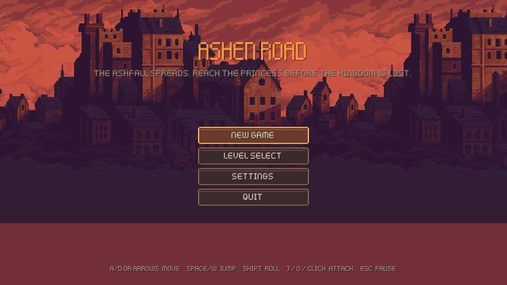
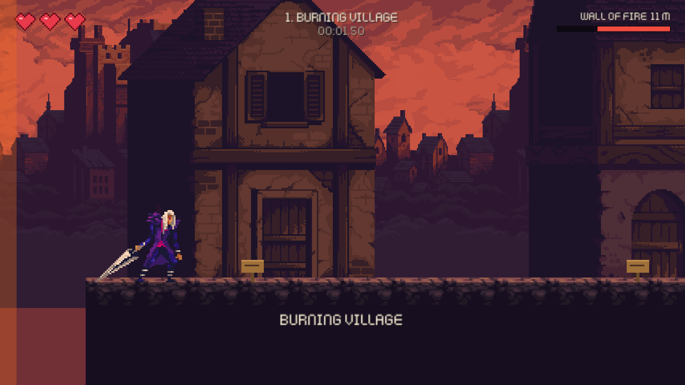
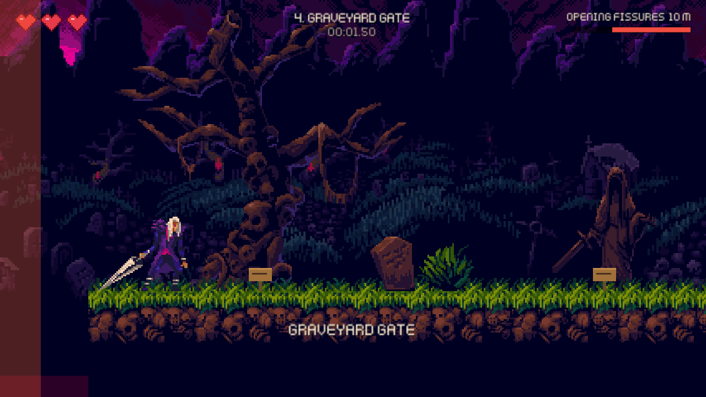
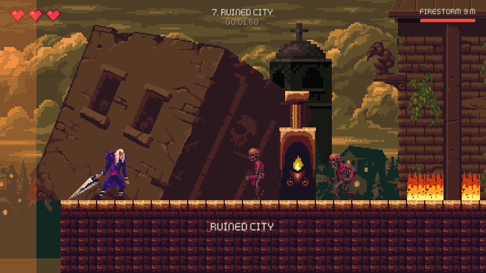

# Ashen Road

A 2D action platformer built in **Unity 6 (6000.6.0f1)** with **C#** for *EC-334 Game Design and Development*.

The Ashfall curse is spreading from the castle and turning the kingdom's people into the undead. You play the last knight
still able to walk the old royal road, and you have to reach the princess before the kingdom is lost. Every level is one
stretch of that road. A **disaster front** (fire, flood, collapsing ground, a cave-in, a storm) advances from the left the
whole time, so every fight costs you distance.

| | |
|---|---|
|  |  |
|  |  |

**Team:** Hassan Ayoub (BCSF23M004) · Hafiz Own (BCSF23M018) · Abdul Basit (BCSF23M022)

---

## Contents

1. [Quick start: play the game](#1-quick-start-play-the-game)
2. [Controls](#2-controls)
3. [How to play](#3-how-to-play)
4. [Open the project in Unity](#4-open-the-project-in-unity)
5. [Command-line scripts](#5-command-line-scripts)
6. [Tests](#6-tests)
7. [Building the game](#7-building-the-game)
8. [Changing the game](#8-changing-the-game)
9. [Project structure](#9-project-structure)
10. [Architecture and design patterns](#10-architecture-and-design-patterns)
11. [Troubleshooting](#11-troubleshooting)
12. [Design documents](#12-design-documents)
13. [Credits and licences](#13-credits-and-licences)

---

## 1. Quick start: play the game

### Option A: a ready-made build (no Unity needed)

Builds are **not stored in git** because each one is about 100 MB. Download the zip for your system from the
repository's **Releases** page, or build it yourself (see [section 7](#7-building-the-game)).

| Download | System |
|---|---|
| `AshenRoad-Linux-v2-Gothicvania.zip` | **Linux** (64-bit), latest version |
| `AshenRoad-Windows-v2.zip` | **Windows** 10/11 (64-bit) |
| `AshenRoad-macOS-v2.zip` | **macOS** 11+ (one app for both Apple Silicon and Intel) |
| `AshenRoad-Linux-v1-Kenney.zip` | Linux, first version with the simpler Kenney art, kept for comparison |

A Unity build is a **folder**, not a single file. Keep everything in the zip together.

**Linux**
```bash
unzip AshenRoad-Linux-v2-Gothicvania.zip
cd Linux-Gothicvania
chmod +x AshenRoad.x86_64        # only needed if the zip lost the executable bit
./AshenRoad.x86_64
```

**Windows:** unzip, open the `Windows` folder and double-click **`AshenRoad.exe`**. Keep `AshenRoad_Data`,
`UnityPlayer.dll` and the other files next to it. The first time, Windows SmartScreen may say *"Windows protected your PC"*
because the game isn't signed. Click **More info → Run anyway**.

**macOS:** unzip and move **`AshenRoad.app`** wherever you like. The app isn't signed with a paid Apple developer ID, so the
first launch is blocked with *"cannot be opened because the developer cannot be verified"*. Do one of these once:
* **right-click (or Control-click) the app → Open → Open**, or
* *System Settings → Privacy & Security* → scroll down → **Open Anyway**, or
* in Terminal: `xattr -cr /path/to/AshenRoad.app`, then open it normally.

**Built locally?** Run it straight from the repository folder:

```bash
./Builds/Linux-Gothicvania/AshenRoad.x86_64     # Linux, latest
./Builds/Linux/AshenRoad.x86_64                 # Linux, first version
# Builds/Windows/AshenRoad.exe and Builds/macOS/AshenRoad.app for the other systems
```

Useful launch options (Linux and Windows):

```bash
./Builds/Linux-Gothicvania/AshenRoad.x86_64 -screen-fullscreen 0 -screen-width 1280 -screen-height 720   # windowed
./Builds/Linux-Gothicvania/AshenRoad.x86_64 -logFile -                                                   # print the log to the terminal
```

### Option B: play inside the Unity editor

See [section 4](#4-open-the-project-in-unity). Open the project, open `Assets/_Project/Scenes/MainMenu.unity`, and press **Play**.

**Requirements:** a 64-bit Linux desktop with OpenGL or Vulkan, Windows 10/11 64-bit, or macOS 11 or newer.

---

## 2. Controls

| Action | Keyboard / mouse | Gamepad |
|---|---|---|
| Move | **A / D** or **← / →** | Left stick, D-pad |
| Jump (hold for higher) | **Space**, **W**, **↑** | South button (A / Cross) |
| Roll: invulnerable, passes through enemies | **Left / Right Shift** | East button (B / Circle), RB |
| Sword | **J**, **0**, **Numpad 0**, **Left click** | West button (X / Square) |
| Pause | **Esc**, **P** | Start |
| Menus | Arrows or mouse, **Enter** to confirm, **Esc** to go back | D-pad, South to confirm, East to go back |

Input uses Unity's **Input System**. Every binding lives in one place:
`Assets/_Project/Scripts/Input/InputBindings.cs` (written out as `Assets/_Project/Input/AshenRoadControls.inputactions`).

---

## 3. How to play

* **Goal:** reach the exit gate at the right end of each level before the disaster front catches you. Level 8 ends in a
  boss fight, and then you reach the princess.
* **You lose a life** at zero hearts, by falling into a pit, or by touching the front. **Retry** restarts from the last
  checkpoint you touched, with the front reset a fair distance behind you and full health.
* **Hearts:** you have 3. Heart potions refill one, but only when you're hurt; otherwise they stay for later.
* **Checkpoints:** each level has two banners, which turn red when touched.

### Enemies

| Enemy | Look | Health | Behaviour | How to beat it |
|---|---|---|---|---|
| **Shambler** | walking skeleton | 2 hits | slow; swipes when close | sword |
| **Runner** | burning ghoul | 1 hit | fast; winds up, then charges | dodge or roll, then strike |
| **Brute** | hell beast | immune to the sword | slow; heavy slam with big knockback | jump over it, roll through it, or lure it into fire |
| **The Ash Warden** (boss) | winged demon | 20 | phase 1: telegraphed swings and Shambler summons. Phase 2 (below half health): faster, charges across the arena | watch the red wind-up, punish the recovery |

### Hazards

Fire patches flare on a timer and burn enemies too. Falling rocks drop when you approach, and a shadow shows where they'll land.
There are also spikes, pits, one-way platforms, and moving platforms (sideways and lifts).

### The eight levels

| # | Level | Disaster front | What's new |
|---|---|---|---|
| 1 | Burning Village | wall of fire | tutorial signs; Shamblers |
| 2 | Broken Bridge | collapsing bridge | pits, falling debris, the roll |
| 3 | Drowned Fields | rising flood | Runners |
| 4 | Graveyard Gate | opening fissures | Brutes; fire to lure them into |
| 5 | Collapsing Mines | cave-in | low ceilings, constant falling rocks |
| 6 | Storm Cliffs | lightning storm | moving platforms and lifts |
| 7 | Ruined City | firestorm | dense mixed groups, fire and debris |
| 8 | Castle Ramparts | crumbling wall | the Ash Warden, then the princess and the credits |

Progress (unlocked levels and best times) and volume settings are saved automatically. **Level Select** shows what is
unlocked, and **Settings → Reset Progress** clears it (press twice to confirm).

---

## 4. Open the project in Unity

1. Install **Unity Hub** and the editor version **6000.6.0f1**. The exact version matters: opening in an older editor can break scenes.
2. Sign in to Unity Hub and activate a license (a free **Personal** license is fine: *Hub → Preferences → Licenses → Add*).
3. *Hub → Projects → Add → Add project from disk* → choose this repository folder.
4. Open `Assets/_Project/Scenes/MainMenu.unity` and press **Play**.

The first open takes a few minutes while Unity rebuilds its `Library/` cache, which is not stored in git.

You can also open `Assets/_Project/Scenes/Level.unity` and press Play to start a level directly. To choose which level,
select the **Level** object and set **Editor Level Index** on the `LevelController` (0 = level 1 … 7 = level 8).

A persistent **Systems** object (GameManager, AudioManager, input, UI) is created automatically before any scene loads
(`GameBootstrap`), so Play works from any scene.

**Packages used** (all bundled with the editor, so no download is needed): Input System 1.20, 2D Sprite, 2D Tilemap,
uGUI, Test Framework.

---

## 5. Command-line scripts

All scripts run Unity **headless** (no window). **Close the project in the Unity editor first**, because Unity can't open the
same project twice. If your editor isn't at `~/Unity/Hub/Editor/6000.6.0f1/Editor/Unity`, set `UNITY`:

```bash
export UNITY=/path/to/Unity/Hub/Editor/6000.6.0f1/Editor/Unity
```

| Script | What it does |
|---|---|
| `./run_tests.sh` | Runs every EditMode and PlayMode test and prints a summary. `./run_tests.sh EditMode` or `./run_tests.sh PlayMode` runs one set. |
| `./build_linux.sh [folder]` | Builds the Linux game. The default folder is `Builds/Linux`; use `./build_linux.sh Builds/Linux-Gothicvania` for the latest-style build. |
| `./build_windows.sh [folder]` | Builds the Windows game (default `Builds/Windows`). Needs *Windows Build Support (Mono)* in Unity Hub. |
| `./build_mac.sh [folder]` | Builds a universal macOS app for Apple Silicon and Intel (default `Builds/macOS`). Needs *Mac Build Support (Mono)*. |
| `./rebuild_assets.sh` | Regenerates the data assets, prefabs and scenes from code and the level files. This is the same as the editor menu **Ashen Road → Rebuild Project Assets**. |
| `./unity.sh <args>` | Runs Unity in batch mode on this project with any extra arguments. |

Python tools (Python 3 with Pillow and NumPy; the CRC tool needs `uv`):

| Tool | What it does |
|---|---|
| `python3 Tools/compose_levels.py` | Re-composes the 8 level layouts (`Assets/_Project/Levels/levelN.txt`), checks each one can be finished, and writes previews to `Tools/previews/`. |
| `python3 Tools/extract_gothicvania.py <packs folder>` | Cuts the Gothicvania art packs (unzipped, one folder per pack) into tiles, animation frames, backgrounds and props. |
| `python3 Tools/gen_art.py` | Regenerates the procedural art: disaster fronts, hazards, UI pieces, and the fallback tiles and backgrounds. |
| `python3 Tools/gen_sfx.py` | Regenerates the synthesised sound effects. |
| `uv run --with reportlab --with python-docx python3 Tools/crc_cards.py docs/design` | Regenerates the CRC cards (PDF and DOCX). |

Logs go to `Logs/`, and test results go to `TestResults/`. Neither folder is in git.

---

## 6. Tests

```bash
./run_tests.sh
```

**106 EditMode** and **29 PlayMode** tests, all passing at the time of writing. Results go to `TestResults/EditMode.xml`
and `TestResults/PlayMode.xml`, and screenshots of every level and screen go to `TestResults/Screens/`.

| Area | What is checked |
|---|---|
| Core | State machine enter/exit order and re-entry; legal and illegal game-state transitions; save data; object pool reuse |
| Combat | Health rules: damage, death, invulnerability, immunity, lethal hits, healing, events |
| Levels | Layout parsing and validation; **every level is finishable** from the start and from every checkpoint, checked with the knight's real jump; front speed rules |
| Data | Catalog, enemy stats (the Brute is immune to the sword), jump maths, prefabs wired, input bindings (incl. J/0/click), every sound present, collision layers |
| Player (play mode) | Grounding, acceleration and momentum, designed jump height, short hop, coyote time, roll, hurt and death, a running jump over a 3-tile gap, a 2-tile ledge, riding a moving platform |
| Combat (play mode) | Sword kills a Shambler in 2 hits and a Runner in 1, can't hurt a Brute; fire kills a Brute; enemies see, chase and attack; enemies spawn facing the knight and come toward him; a roll passes through enemies; kill zones; hearts; falling rocks |
| Flow (play mode) | All 8 levels load and run; reaching the exit completes the level and unlocks the next; the front kills an idle knight; retry restarts at the checkpoint; pause; the boss's two phases, defeat, ending and credits |

PlayMode tests run silently (audio is muted while they run) and use an in-memory save, so they never touch your real progress.

---

## 7. Building the game

From the command line (close the editor first):

```bash
./build_linux.sh Builds/Linux-Gothicvania     # Linux, latest build (what the Quick start runs)
./build_windows.sh                            # Windows  -> Builds/Windows/AshenRoad.exe
./build_mac.sh                                # macOS    -> Builds/macOS/AshenRoad.app (universal)
```

From the editor: **Ashen Road → Build Linux Player / Build Windows Player / Build macOS Player**, or *File → Build
Profiles*. Every build includes the scenes `MainMenu` and `Level`, in that order, and needs no code changes per platform.

**Build modules:** Linux works out of the box. For Windows and macOS, add the modules in *Unity Hub → Installs →
6000.6.0f1 → ⚙ → Add modules → Windows Build Support (Mono) / Mac Build Support (Mono)*. Without a module, the script
stops and says which one is missing.

**Publishing a release:** zip each build folder and attach the zips to a GitHub Release. Don't commit build folders,
since `Builds/` and `Releases/` are git-ignored on purpose. Zip the Mac app with `-y` so its internal links survive.

```bash
cd Builds
zip -r  ../Releases/AshenRoad-Linux-v2-Gothicvania.zip Linux-Gothicvania
zip -r  ../Releases/AshenRoad-Windows-v2.zip Windows
(cd macOS && zip -ry ../../Releases/AshenRoad-macOS-v2.zip AshenRoad.app)
```

On GitHub: *Releases → Draft a new release → choose a tag (e.g. `v2.0`) → attach the zips → Publish*.

## 8. Changing the game

| To change | Edit |
|---|---|
| Knight feel: speed, jump, roll, sword, hearts | `Assets/_Project/Data/PlayerStats.asset` |
| Enemy stats | `Assets/_Project/Data/Enemies/*.asset` |
| Boss | `Assets/_Project/Data/Boss/AshWarden.asset` |
| A level's look, front speed, hints, music | `Assets/_Project/Data/Levels/LevelN.asset` |
| A level's layout | `Assets/_Project/Levels/levelN.txt`, then `./rebuild_assets.sh` |
| Sounds and music | `Assets/_Project/Data/AudioLibrary.asset` |
| Character animations | `Assets/_Project/Data/Art/*.asset` |
| UI colours and fonts | `Assets/_Project/Data/UIStyle.asset` |

**Important:** the data assets, prefabs and scenes are **generated** by `Assets/_Project/Editor/ProjectAssetBuilder*.cs`.
An Inspector edit works immediately, but the next `./rebuild_assets.sh` overwrites it. To make a change permanent, put the
value in the builder (`ProjectAssetBuilder.Data.cs` for stats, `ProjectAssetBuilder.Art.cs` for looks) or in the level `.txt` file.

### Level layout format

One character per 1×1 tile. The first line is the top row. Every level is 15 rows tall.

```
#  ground            =  one-way platform     ^  spikes          F  fire patch
D  falling rock      M  moving platform →    V  moving platform ↑
S  Shambler          R  Runner               B  Brute
H  heart             C  checkpoint           P  knight start    E  exit gate
K  boss              Q  princess             |  arena wall      !  tutorial sign
d  decoration        .  empty
```

`LevelLayout.Validate` and the reachability test catch broken layouts, for example a missing exit, something floating, or a gap too wide to jump.

---

## 9. Project structure

```
AshenRoad/
├── Assets/
│   ├── _Project/
│   │   ├── Scripts/            game code (assembly AshenRoad.Runtime)
│   │   │   ├── Core/           GameManager, GameEvents, StateMachine, GameState rules, SaveSystem, ObjectPool, SceneLoader
│   │   │   ├── Input/          InputReader, InputBindings
│   │   │   ├── Data/           ScriptableObjects: PlayerStats, EnemyData, BossData, LevelData, LevelCatalog, CharacterArt …
│   │   │   ├── Combat/         IDamageable, DamageInfo, Health + HealthModel, Hitbox, ContactDamage
│   │   │   ├── Player/         PlayerController, PlayerMovement, PlayerCombat, States/
│   │   │   ├── Enemies/        EnemyAI, EnemyMotor, EnemyPerception, EnemyFactory, States/
│   │   │   ├── Boss/           BossController, States/
│   │   │   ├── Level/          LevelController, LevelBuilder, LevelLayout, LevelReachability, DisasterFront, Hazards/ …
│   │   │   ├── Cameras/        CameraFollow
│   │   │   ├── Audio/          AudioManager
│   │   │   ├── UI/             UIFlowController and one panel per screen, HUD, ScreenFader
│   │   │   └── Visual/         SpriteAnimator, Player/Enemy/BossAnimator, EffectPlayer
│   │   ├── Editor/             ProjectAssetBuilder (generates everything), BuildScript
│   │   ├── Data/               generated data assets
│   │   ├── Prefabs/            generated prefabs
│   │   ├── Scenes/             MainMenu, Level
│   │   ├── Levels/             level1.txt … level8.txt
│   │   ├── Resources/          Systems prefab (created at start-up)
│   │   ├── Art/                Gothicvania/, Kenney/, Generated/, Fonts/
│   │   └── Audio/              Music/, Sfx/
│   └── Tests/                  EditMode/ and PlayMode/
├── Tools/                      Python tools (levels, art, sound, CRC cards)
├── docs/                       screenshots and design documents
├── run_tests.sh  build_linux.sh  rebuild_assets.sh  unity.sh
├── Packages/  ProjectSettings/
└── Builds/  Releases/  Library/  Logs/  TestResults/   (git-ignored)
```

---

## 10. Architecture and design patterns

| Pattern | Where | Why |
|---|---|---|
| **Singleton** | `GameManager`, `AudioManager` | One persistent owner of the game flow and of sound. There are only two, to keep global state small. |
| **Observer** | `GameEvents`, plus C# events on `Health`, `StateMachine`, `Hitbox` | The HUD, audio, camera and GameManager react to deaths, hits and checkpoints without the sender knowing about them. |
| **State** | `IState` + `StateMachine`; knight, enemy and boss states; `GameState` | Behaviour changes by state instead of one large if/else. |
| **Component** | Knight = Controller + Movement + Combat + Health; every enemy shares Health, Motor and Perception | New enemy types are new combinations and data, not new classes. |
| **Factory** | `EnemyFactory` | The only place enemies are created: the spawn tables and the boss's summons. |
| **Object Pool** | `ObjectPool<T>` for particles and falling rocks | These spawn constantly, so pooling avoids repeated Instantiate and Destroy. |
| **Template Method** | `Hazard` (fire, rocks, spikes); `BossCombatState` (two phases) | The fixed cycle lives in the base class, and each subclass fills in the steps. |
| **Facade** | `PlayerController` | The rest of the game talks to one knight object. |
| **Type Object / data-driven** | `EnemyData`, `LevelData`, `BossData`, `CharacterArt` | Shambler, Runner and Brute are three data assets on one prefab, and levels are text files. |

Other course ideas are applied throughout: read input in `Update` and act in `FixedUpdate` (latching); a jump designed
from height and time (`g = 2h/t²`); coyote time and a jump buffer; camera follow with bounds; triggers versus solid
colliders and a collision matrix; encapsulation (`HealthModel`); interfaces (`IDamageable`, `ISaveStore`); and low
coupling through events.

The full class-by-class breakdown is in [`docs/design/Ashen_Road_CRC_Cards_v2.pdf`](docs/design/Ashen_Road_CRC_Cards_v2.pdf).

---

## 11. Troubleshooting

| Problem | Fix |
|---|---|
| The build won't start: `Permission denied` | `chmod +x AshenRoad.x86_64` |
| macOS: *"developer cannot be verified"* or *"is damaged"* | Right-click → Open, or run `xattr -cr AshenRoad.app` (see [section 1](#1-quick-start-play-the-game)). |
| Windows: *"Windows protected your PC"* | Click **More info → Run anyway**. The build is not code-signed. |
| The build starts and closes immediately | Run it with `-logFile -` to see the error. Make sure the whole build folder was copied. |
| Scripts fail with *"Access token is unavailable"* / *"com.unity.editor.headless not found"* | Sign in to Unity Hub and activate a Personal license, then run the script again. |
| Scripts fail with *"another Unity instance is running"* | Close the project in the editor, or end the stray `Unity -batchmode` process. |
| Scripts fail with `.../Editor/Unity: No such file or directory` | Set `UNITY` to your editor path (see [section 5](#5-command-line-scripts)). |
| My Inspector changes disappeared | `rebuild_assets.sh` regenerates data. Put permanent values in the builder (see [section 8](#8-changing-the-game)). |
| Reset saved progress outside the game | Linux keeps PlayerPrefs in `~/.config/unity3d/EC-334 Group/Ashen Road/`. |
| Pink or missing sprites after a pull | Run `./rebuild_assets.sh` (or the menu item) so Unity re-imports and regenerates. |

---

## 12. Design documents

| File | Contents |
|---|---|
| [`docs/design/Ashen_Road_Proposal_1.docx`](docs/design/Ashen_Road_Proposal_1.docx) | The original project proposal (concept, SDLC plan, patterns) |
| [`docs/design/Ashen_Road_CRC_Cards_v2.pdf`](docs/design/Ashen_Road_CRC_Cards_v2.pdf) / [`.docx`](docs/design/Ashen_Road_CRC_Cards_v2.docx) | CRC cards for every class, as built |
| [`docs/design/AshenRoad_Build_Plan.md`](docs/design/AshenRoad_Build_Plan.md) | The build plan this project followed |
| [`docs/screenshots/`](docs/screenshots/) | Screenshots of every level and screen |

---

## 13. Credits and licences

**Art**
* Characters, tiles, backgrounds and scenery: the *Gothicvania* packs by **Luis Zuno ([@ansimuz](https://ansimuz.com))**
  (Town, Cemetery, Church, Swamp, Rocky Pass, Junk Wastelands, Bridge expansion, Patreon collection). They are **CC0 /
  public domain**, from [OpenGameArt](https://opengameart.org/users/ansimuz).
* Items, UI and RPG sounds, plus the v1 characters and fonts: **Kenney** ([kenney.nl](https://kenney.nl)), CC0.
* Disaster fronts, hazards, UI pieces and some sound effects are generated by the scripts in `Tools/`.

**Fonts:** *Cinzel Decorative* (Natanael Gama) and *Alegreya Sans* (Huerta Tipográfica), SIL Open Font License 1.1, from Google Fonts.

**Music:** Juhani Junkala, *Retro Game Music Pack*, CC0.

The original licence text of each pack is kept next to the files, for example
`Assets/_Project/Art/Gothicvania/License_Gothicvania.txt`, `Assets/_Project/Art/Kenney/License_TinyDungeon.txt`
and `Assets/_Project/Audio/Music/License_JuhaniJunkala.txt`.

**Code:** written for EC-334 by the team above. No open-source licence has been chosen yet, so add a `LICENSE` file
before making the repository public if you want others to reuse the code.
